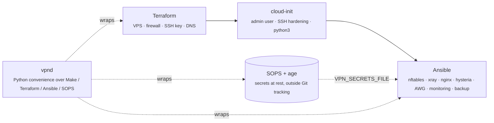

# vpn-deploy

[](https://github.com/po4yka/ripdpi-vpn-deploy/actions/workflows/ci.yml)
[](https://github.com/po4yka/ripdpi-vpn-deploy/actions/workflows/codeql.yml)
[](https://securityscorecards.dev/viewer/?uri=github.com/po4yka/ripdpi-vpn-deploy)
[](https://github.com/po4yka/ripdpi-vpn-deploy/releases)

Reproducible infrastructure-as-code for a small, disposable VPN fleet that
keeps a handful of devices online through a filtered network. Terraform
creates the VPS, cloud-init hardens first boot, Ansible owns every byte of
runtime state, SOPS with age keeps secrets out of Git, and `vpnd` wraps the
whole thing for an operator. The threat model is active L7 fingerprinting,
active probing and aggressive QoS; the answer is several independent
transports per node and nodes that are recreated, never repaired.

## Security

Report active probing of a live node, a burned address or a leaked key
through the private channel in [SECURITY.md](.github/SECURITY.md); never in
a public issue. Never post credentials, addresses, hostnames, client
identifiers, Terraform state or inventory anywhere, redacted or not.

## What you get

| Profile | Transport | Listener | Purpose |
|---|---|---|---|
| P0 | VLESS + REALITY + XTLS-Vision (Xray) | TCP/443 | Filtered-path baseline; borrows an allowlisted TLS identity |
| P1 | VLESS + XHTTP behind a real nginx site | TCP/8443 or 443 | Browser-shaped HTTPS, direct, no CDN |
| P2 | Hysteria2 with Salamander | UDP/443 | QUIC-class alternative with optional port hopping |
| P2 | AmneziaWG 2.0 cohorts | UDP, per cohort | Device-wide tunnel with tuned obfuscation profiles |
| P3 | Manual reachability fallbacks | — | Alternate addresses and ports, egress isolation, recreate on burn |

Clients carry selector and urltest logic, so a device fails over to whichever
profile is still reachable. Deploy profiles in `ansible/group_vars/vpn-*.yml`
choose which transports a host exposes: `vpn-family-standard` is P0 + P1 + P2
Hysteria2, `vpn-device-full` adds AmneziaWG. Why each layer exists is in
[the threat model](docs/explanation/threat-model.md).

## How it is built



Layer ownership is strict ([architecture](docs/reference/architecture.md),
[rationale](docs/explanation/architecture-rationale.md)). Every layer is
dry-runnable and has a rollback path. The Makefile is the canonical operator
surface; [the target reference](docs/reference/make-targets.md) mirrors `make help`.

## Quick start

[The quickstart](docs/tutorials/quickstart.md) takes a new operator from an empty
provider account to a working node and a first client in about thirty minutes:

```bash
make init PROVIDER=upcloud       # terraform init for the chosen provider
make validate                    # fmt, validate, gitleaks, ansible-lint
make decrypt && make plan        # plaintext secrets live only until `make clean`
make apply && make inventory && make wait
make dry-run && make deploy && make verify
make emit-singbox CLIENT=laptop  # first client config
make clean                       # shred the plaintext
```

Every target that touches cloud credentials, inventory, SSH or decrypted
secrets stops for review and runs only when an operator has authorised it.

## Documentation

[docs/README.md](docs/README.md) lists every page by type and tier. The pages
most operators open:

| Need | Page |
|---|---|
| Deploy or re-deploy, add a device | [how-to/deploy.md](docs/how-to/deploy.md) |
| Something broke after a change | [how-to/rollback.md](docs/how-to/rollback.md) |
| An address burned, a key leaked, SSH is gone | [how-to/incident.md](docs/how-to/incident.md) |
| Rotate one device or a server-wide key | [how-to/rotate.md](docs/how-to/rotate.md) |
| Rebuild after host loss | [how-to/restore.md](docs/how-to/restore.md) |
| The secrets model and age key recovery | [reference/secrets.md](docs/reference/secrets.md), [how-to/age-recovery.md](docs/how-to/age-recovery.md) |
| Why the design looks like this | [explanation/threat-model.md](docs/explanation/threat-model.md), [decisions/](docs/decisions/README.md) |
| What CI covers and what it cannot | [reference/testing.md](docs/reference/testing.md) |

Coding agents read the same tree as `docs/llms.txt`; releases are in [CHANGELOG.md](CHANGELOG.md).

## Providers

One Terraform root per provider with identical outputs keeps Ansible provider-neutral;
select one with `make PROVIDER=<name> …`. Versions are locked per root:
[UpCloud](terraform/providers/upcloud/.terraform.lock.hcl), [Hetzner](terraform/providers/hetzner/.terraform.lock.hcl),
[Vultr](terraform/providers/vultr/.terraform.lock.hcl), [Scaleway](terraform/providers/scaleway/.terraform.lock.hcl).
Capabilities, ASN tiers to avoid and fallback transport tiers are in [the provider notes](docs/reference/provider-notes.md).

## For contributors and agents

- [CONTRIBUTING.md](CONTRIBUTING.md): setup, pull request flow, commit conventions; [SUPPORT.md](SUPPORT.md): where to ask.
- [AGENTS.md](AGENTS.md): the working rules for every coding agent and contributor; the root `CLAUDE.md` imports it and each subtree carries its own folder note.
- [docs/STYLE.md](docs/STYLE.md): how documentation is organised and written; [docs/tasks/README.md](docs/tasks/README.md): the task board.
- `vpnd` needs Python 3.12; see [vpnd/README.md](vpnd/README.md).

## Hard rules

The full list, with reasons, is in [AGENTS.md](AGENTS.md#hard-rules).

- Secrets never enter Git, Terraform inputs or outputs, cloud-init
  `user_data`, Ansible output or screenshots; provider credentials live in
  environment variables only; state files are sensitive.
- One UUID, one REALITY shortId and one AmneziaWG peer key per device, never
  shared, so one device can be revoked without touching another.
- No public admin panel and no remote installer piped into a root shell.
- A CDN is not the filtered-path baseline
  ([decision 0001](docs/decisions/0001-cdn-not-filtered-path-baseline.md)).
- Every version is pinned; pre-releases go through staging only.

## License

[BSD 3-Clause](LICENSE).
