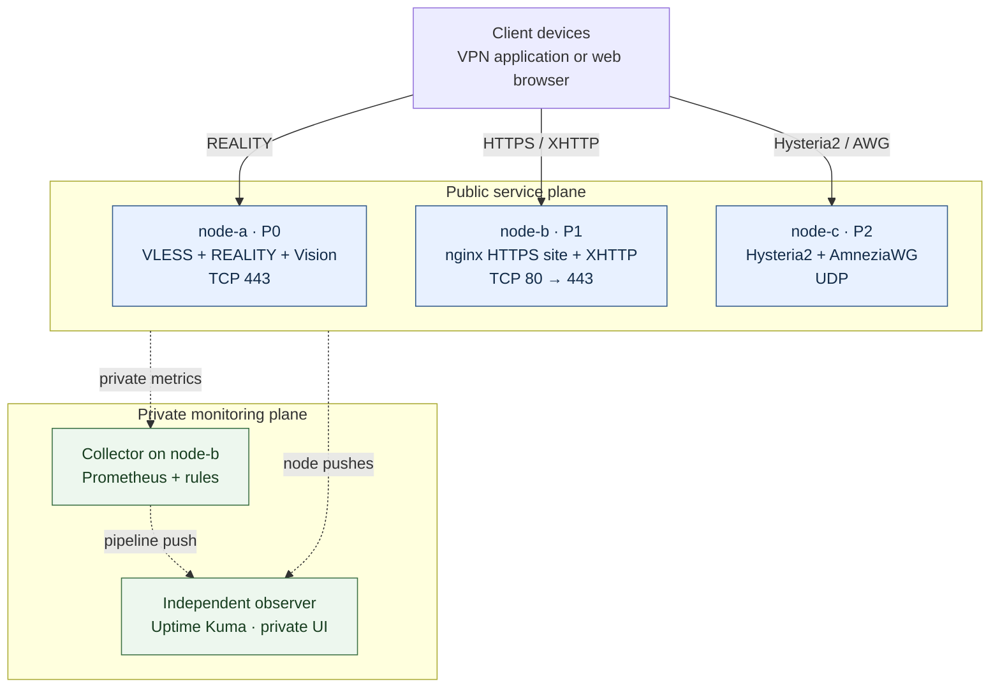
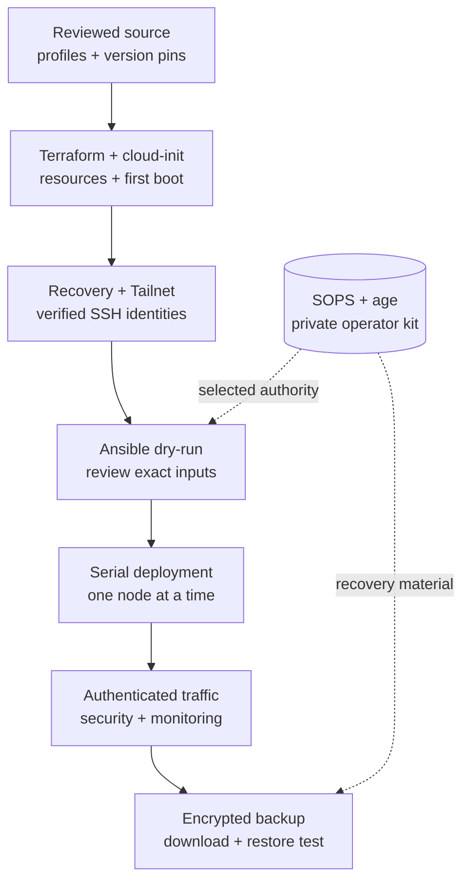

# vpn-deploy

[](https://github.com/po4yka/ripdpi-vpn-deploy/actions/workflows/ci.yml)
[](https://github.com/po4yka/ripdpi-vpn-deploy/actions/workflows/codeql.yml)
[](https://securityscorecards.dev/viewer/?uri=github.com/po4yka/ripdpi-vpn-deploy)
[](https://github.com/po4yka/ripdpi-vpn-deploy/releases)

Reproducible infrastructure for a small VPN service with four transport options,
a public HTTPS site, private monitoring and encrypted recovery. Terraform owns
cloud resources. Ansible owns runtime configuration. SOPS with age protects
secrets at rest. The Makefile is the operator interface; `vpnd` wraps it.

## Service at a glance

The [verified deployment snapshot](docs/reference/deployment-status.md) records
the four-host service checked on **4 November 2026 at 05:55 UTC**. It is dated
evidence, not a live status page. It also records the separate security-report
audit at **09:00 UTC**. New commits on `main` do not update running servers.



The browser uses the HTTPS site on node-b. VPN applications select a supported
transport. Solid arrows carry public traffic. Dashed arrows carry private
monitoring traffic; each node sends its own heartbeat. Tailscale carries management and private monitoring traffic; VPN
clients use the declared public service endpoints. The panel has no public
admin listener. The deployed mode uses three node monitors and one pipeline
monitor, without Telegram bots.

## Transports

| Profile | Transport | Listener | Use |
|---|---|---|---|
| P0 | VLESS + REALITY + XTLS-Vision (Xray) | TCP/443 | Filtered-path baseline |
| P1 | VLESS + XHTTP behind nginx | TCP/443 on a separate host; TCP/8443 on a combined host | Direct HTTPS transport, no CDN baseline |
| P2 | Hysteria2 with Salamander | UDP/443 | Alternative to the TCP transports |
| P2 | AmneziaWG 2.0 cohorts | UDP, per cohort | Device-wide tunnel |
| P3 | Manual reachability fallbacks | Explicit alternate endpoints | Recovery when the selected path fails |

[Deployment profiles](docs/reference/deploy-profiles.md) select the listener
surface. [Client notes](docs/reference/client-notes.md) describe engine support;
not every client implements every transport. A passing service check does not
prove reachability from each user's network.

The merged transport changes support bounded XHTTP pools, payload-based failover
and TCP reserves. These options remain off in the recorded deployment. Activation
needs the paired RIPDPI client and two owned HTTPS controls with verified bodies.
See [XHTTP profiles](docs/reference/xhttp-delivery-profiles.md) and
[the payload policy](docs/reference/ripdpi-bundle.md#ripdpipayload_failover).

## Deployment and recovery



[Architecture](docs/reference/architecture.md) defines layer ownership. A fresh
node needs recovery, enrollment and SSH admission before runtime deployment.
Existing nodes use the reviewed deployment transaction and retain rollback.
The [operator kit](docs/how-to/local-operator-kit.md) records actual configuration,
credentials, source and state recovery outside Git tracking.

## Start here

| Goal | Guide |
|---|---|
| Understand what was deployed and what remains unverified | [Deployment snapshot](docs/reference/deployment-status.md) |
| Set up the workstation and build the first node | [Contributor setup](CONTRIBUTING.md#first-time-setup), [quickstart](docs/tutorials/quickstart.md) |
| Resume an interruption or check release and recovery inputs | [Operator maintenance](docs/how-to/operator-maintenance.md) |
| Resume a reviewed node operation or back up the complete operator kit | [Fleet maintenance and recovery](docs/how-to/fleet-maintenance.md) |
| Deploy a reviewed change to an existing node | [Deployment runbook](docs/how-to/deploy.md) |
| Configure public HTTPS or inspect certificate renewal | [Certificates](docs/how-to/certificates.md) |
| Operate the private collector and Kuma | [Observability operations](docs/reference/observability-operations.md) |
| Recover a host, the operator kit or encrypted state | [Restore](docs/how-to/restore.md), [local operator kit](docs/how-to/local-operator-kit.md) |
| Recover from a failed change or lost access | [Rollback](docs/how-to/rollback.md), [incidents](docs/how-to/incident.md) |
| Issue or revoke device access | [Device lifecycle](docs/how-to/device-lifecycle.md), [rotation](docs/how-to/rotate.md) |
| Review daily security findings or collect private host reports | [Security checks](docs/how-to/security-checks.md) |
| Check source and deployment evidence | [Testing](docs/reference/testing.md), [Make targets](docs/reference/make-targets.md) |

For a new installation, start with the quickstart prerequisites. Its plan phase
stops before resource mutation:

```bash
export PROVIDER=upcloud          # or hetzner, vultr, scaleway
(
  set -e
  trap 'make clean || exit $?' EXIT
  make init
  make validate
  make decrypt && make plan
)
```

Review the exact account, environment, costs and replacements before apply.
This block needs prepared private inputs; it is not a full bootstrap recipe.
`make clean` removes the selected plaintext secrets file, not every temporary
file. Live Make targets use real credentials and do not ask for confirmation.

## Providers and ownership

Terraform has one root per provider: [UpCloud](terraform/providers/upcloud/),
[Scaleway](terraform/providers/scaleway/), [Vultr](terraform/providers/vultr/)
and [Hetzner](terraform/providers/hetzner/). Provider support does not mean that
a server exists at every provider. The accepted service uses three VPN nodes
and one independent observer; no personal device hosts a service component.
[Provider notes](docs/reference/provider-notes.md) explain selection constraints.

## Security and contributions

- Keep credentials, endpoints, private inventory, client identifiers and raw
  diagnostics out of public issues. Use the private route in
  [SECURITY.md](.github/SECURITY.md).
- Never commit live secrets, Terraform state or saved plans. `.gitignore` does
  not encrypt files. Keep durable secrets in SOPS/age and verify recovery.
- Give every device separate credentials. Keep admin panels private. Pin
  releases and review changes before deployment.
- Source CI, running-service checks, authenticated client traffic and restored
  backups prove different things. Record their dates and limitations.
- [Daily security scans](.github/SECURITY.md#daily-dependency-and-image-checks)
  report dependency and image findings without inspecting live hosts. The separate
  [host audit](docs/how-to/security-checks.md#run-the-host-audit) collects private
  server reports.

[CONTRIBUTING.md](CONTRIBUTING.md) covers development;
[AGENTS.md](AGENTS.md) defines repository rules;
[docs/README.md](docs/README.md) indexes the full documentation;
[docs/llms.txt](docs/llms.txt) is generated for tools.
See [CHANGELOG.md](CHANGELOG.md) for releases and [SUPPORT.md](SUPPORT.md) for help.

## License

[BSD 3-Clause](LICENSE).
