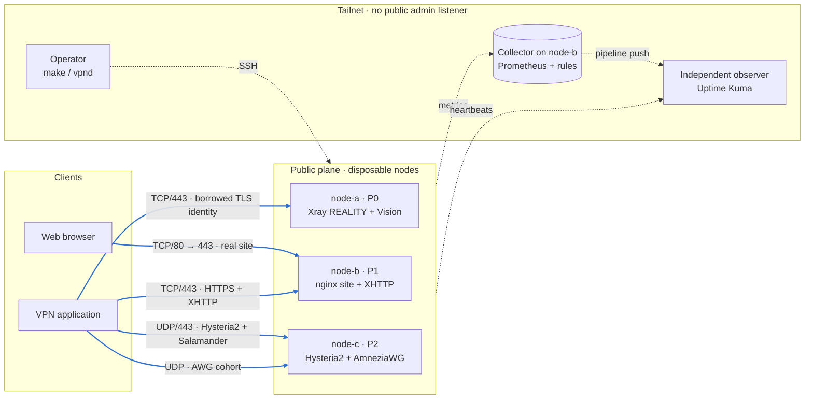
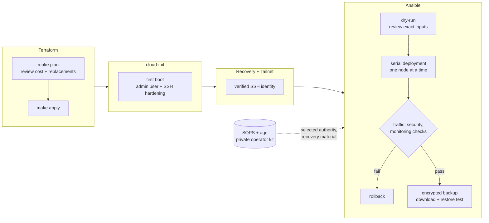

# vpn-deploy

[](https://github.com/po4yka/ripdpi-vpn-deploy/actions/workflows/ci.yml)
[](https://github.com/po4yka/ripdpi-vpn-deploy/actions/workflows/codeql.yml)
[](https://securityscorecards.dev/viewer/?uri=github.com/po4yka/ripdpi-vpn-deploy)
[](https://github.com/po4yka/ripdpi-vpn-deploy/releases)

Reproducible infrastructure for a small VPN service on a filtered network path. The path does deep packet inspection: it inspects SNI, fingerprints TLS-in-TLS, probes servers actively and throttles UDP. Four transport tiers answer these behaviours, and each tier has a different wire shape. The [threat model](docs/explanation/threat-model.md) maps each observed behaviour to its design answer.

Nodes are disposable. When an address is listed, recreate the node from Git and encrypted secrets; do not repair it in place.

## Service at a glance

> [!NOTE]
> The [verified deployment snapshot](docs/reference/deployment-status.md) records the four-host service checked on **4 November 2026 at 05:55 UTC** and the separate security-report audit at **09:00 UTC**. It is dated evidence, not a live status page. New commits on `main` do not update running servers.



Solid lines are public client traffic on the declared service endpoints. Dashed lines stay inside the Tailnet: management SSH, private metrics, one heartbeat from each node and one pipeline push from the collector. The deployed mode uses three node monitors and one pipeline monitor, without Telegram bots.

## Transports

| Profile | Transport | Listener | Wire shape | Answers |
|---|---|---|---|---|
| P0 | VLESS + REALITY + XTLS-Vision (Xray) | TCP/443 | TLS 1.3 with a borrowed real-site identity; probes see that site | SNI allowlists, TLS-in-TLS fingerprints, active probing |
| P1 | VLESS + XHTTP behind nginx | TCP/443 on a separate host; TCP/8443 on a combined host | Browser-shaped HTTPS in front of a real decoy site; direct, no CDN | Protocol fingerprints, active probing |
| P2 | Hysteria2 with Salamander | UDP/443 | Obfuscated QUIC, optional port hopping | UDP throttling, QUIC degradation |
| P2 | AmneziaWG 2.0 cohorts | UDP, per cohort | Device-wide tunnel with junk packets and tuned header shapes | UDP throttling |
| P3 | Manual reachability fallbacks | Explicit alternate endpoints | Operator-selected | Recovery when the selected path fails |

[Deployment profiles](docs/reference/deploy-profiles.md) select the listener surface. [Client notes](docs/reference/client-notes.md) describe engine support; not every client implements every transport. A passing service check does not prove reachability from each user's network. The CDN is not the filtered-path baseline: see [decision 0001](docs/decisions/0001-cdn-not-filtered-path-baseline.md).

The merged transport changes support bounded XHTTP pools, payload-based failover and TCP reserves. These options remain off in the recorded deployment. Activation needs the paired RIPDPI client and two owned HTTPS controls with verified bodies. See [XHTTP profiles](docs/reference/xhttp-delivery-profiles.md) and [the payload policy](docs/reference/ripdpi-bundle.md#ripdpipayload_failover).

## Layers and deployment

Each layer owns one part of the system. Nothing crosses these boundaries except through documented interfaces; [architecture](docs/reference/architecture.md) has the full map.

| Layer | Owns |
|---|---|
| Terraform | VPS, provider firewall, SSH key, DNS, floating IP |
| cloud-init | Admin user, SSH hardening, python3, marker file |
| Ansible | All runtime state: packages, nftables, Xray, nginx, Hysteria2, AmneziaWG, monitoring, backup |
| SOPS + age | Secrets at rest, outside Git tracking |
| `vpnd` | Convenience CLI in front of Make, Terraform, Ansible and SOPS; never a replacement |



A fresh node needs recovery, enrollment and SSH admission before runtime deployment. Existing nodes use the reviewed deployment transaction and retain rollback. The [operator kit](docs/how-to/local-operator-kit.md) records actual configuration, credentials, source and state recovery outside Git tracking.

## Start here

**Learn the system**

- What was deployed and what remains unverified: [deployment snapshot](docs/reference/deployment-status.md)
- Source and deployment evidence: [testing](docs/reference/testing.md), [Make targets](docs/reference/make-targets.md)

**Build or change nodes**

- Set up the workstation and build the first node: [contributor setup](CONTRIBUTING.md#first-time-setup), [quickstart](docs/tutorials/quickstart.md)
- Deploy a reviewed change to an existing node: [deployment runbook](docs/how-to/deploy.md)
- Configure public HTTPS or inspect certificate renewal: [certificates](docs/how-to/certificates.md)
- Issue or revoke device access: [device lifecycle](docs/how-to/device-lifecycle.md), [rotation](docs/how-to/rotate.md)

**Operate and recover**

- Resume an interruption or check release and recovery inputs: [operator maintenance](docs/how-to/operator-maintenance.md)
- Resume a reviewed node operation or back up the complete operator kit: [fleet maintenance and recovery](docs/how-to/fleet-maintenance.md)
- Operate the private collector and Kuma: [observability operations](docs/reference/observability-operations.md)
- Recover a host, the operator kit or encrypted state: [restore](docs/how-to/restore.md), [local operator kit](docs/how-to/local-operator-kit.md)
- Recover from a failed change or lost access: [rollback](docs/how-to/rollback.md), [incidents](docs/how-to/incident.md)
- Review daily security findings or collect private host reports: [security checks](docs/how-to/security-checks.md)

> [!WARNING]
> Live Make targets use real credentials and do not ask for confirmation. Review the exact account, environment, costs and replacements before `make apply`.

<details>
<summary>Plan a new installation (stops before resource mutation)</summary>

Start with the [quickstart prerequisites](docs/tutorials/quickstart.md). This block needs prepared private inputs; it is not a full bootstrap recipe.

```bash
export PROVIDER=upcloud          # or hetzner, vultr, scaleway
(
  set -e
  trap 'make clean || exit $?' EXIT
  make init
  make validate
  make decrypt && make plan
)
```

`make clean` removes the selected plaintext secrets file, not every temporary file.

</details>

## Providers

Terraform has one root per provider: [UpCloud](terraform/providers/upcloud/), [Scaleway](terraform/providers/scaleway/), [Vultr](terraform/providers/vultr/) and [Hetzner](terraform/providers/hetzner/). Provider support does not mean that a server exists at every provider. The accepted service uses three VPN nodes and one independent observer; no personal device hosts a service component. [Provider notes](docs/reference/provider-notes.md) explain selection constraints.

## Security and contributions

- Keep credentials, endpoints, private inventory, client identifiers and raw diagnostics out of public issues. Use the private route in [SECURITY.md](.github/SECURITY.md).
- Never commit live secrets, Terraform state or saved plans. `.gitignore` does not encrypt files. Keep durable secrets in SOPS/age and verify recovery.
- Give every device separate credentials. Keep admin panels private. Pin releases and review changes before deployment.
- Source CI, running-service checks, authenticated client traffic and restored backups prove different things. Record their dates and limitations.
- [Daily security scans](.github/SECURITY.md#daily-dependency-and-image-checks) report dependency and image findings without inspecting live hosts. The separate [host audit](docs/how-to/security-checks.md#run-the-host-audit) collects private server reports.

[CONTRIBUTING.md](CONTRIBUTING.md) covers development; [AGENTS.md](AGENTS.md) defines repository rules; [docs/README.md](docs/README.md) indexes the full documentation; [docs/llms.txt](docs/llms.txt) is generated for tools. See [CHANGELOG.md](CHANGELOG.md) for releases and [SUPPORT.md](SUPPORT.md) for help.

## License

[BSD 3-Clause](LICENSE).
