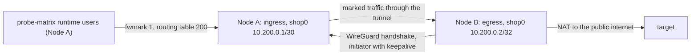

# Runbook: stand up a split-hop pilot

> **Status:** Current · **Type:** how-to · **Tier:** RESEARCH · **Reviewed:** 2026-11-05

## Purpose and scope

Stand up the two-node split-hop research topology from [decision 0003](../decisions/0003-split-hop-relay-topology.md) to prove the ingress and egress separation, not to migrate family production traffic.

Both halves are Ansible-managed. By default the ingress role policy-routes only dedicated probe-matrix runtime users. [Family egress scope](#6-family-egress-scope) extends it to every Xray, Hysteria and AmneziaWG recipient flow on Node A; it stays RESEARCH tier and needs its own staging evidence.



Node B starts the tunnel. Node A only answers, so it has no `Endpoint` and no keepalive for the peer.

## Preconditions

- Two disposable VPS environments provisioned through any supported Terraform roots, with separate provider state and SOPS scopes.
- Node A's typed `public_listeners` contract admits `split_hop_ingress_listen_port` (default 51821) over UDP.
- SOPS + age and the operator SSH identity are configured as in `docs/reference/secrets.md`.
- WireGuard tools are available only for local key generation; Ansible installs them on both nodes.

## Authorization

Every target below that uses cloud credentials, inventory, SSH or decrypted secrets needs the operator's authorization for this environment, target and plan before it runs ([decision boundaries](../../AGENTS.md#decision-boundaries)). A reviewable plan or dry-run precedes every mutation. The pilot is RESEARCH tier: it runs on lab or staging hosts only and never in a family profile.

## 1. Generate node-specific keys

Run on the operator workstation in a mode-0700 directory:

```bash
umask 077
mkdir -p "$HOME/.config/vpn-provision/split-hop"
cd "$HOME/.config/vpn-provision/split-hop"
wg genkey | tee node-a.key | wg pubkey > node-a.pub
wg genkey | tee node-b.key | wg pubkey > node-b.pub
wg genpsk > shared.psk
```

Never share a private key between nodes. Load the values into the encrypted SOPS file for each node:

```yaml
# Node A only
split_hop_ingress_secrets:
  node_a_private_key: "<node-a.key>"
  node_b_public_key: "<node-b.pub>"
  preshared_key: "<shared.psk, or empty>"
```

```yaml
# Node B only
split_hop_egress_secrets:
  node_b_private_key: "<node-b.key>"
  node_a_public_key: "<node-a.pub>"
  node_a_public_ip: "<Node A public IPv4>"
  preshared_key: "<same shared.psk, or empty>"
```

Validate each encrypted file through its normal environment:

```bash
PROVIDER=<provider-a> ENV=<env-a> make decrypt validate-secrets clean
PROVIDER=<provider-b> ENV=<env-b> make decrypt validate-secrets clean
```

Delete the temporary key files after both encrypted files have been verified.

## 2. Configure Node B (egress)

In Node B host vars or its lab cohort:

```yaml
allow_research_roles: [split-hop-egress]
vpn:
  enable_split_hop_egress: true
  enable_split_hop_ingress: false
  enable_xray_reality: false
  enable_nginx_xhttp: false
  enable_hysteria: false
  enable_amneziawg: false
```

Review and deploy through the ordinary provider/environment boundary:

```bash
PROVIDER=<provider-b> ENV=<env-b> make dry-run
PROVIDER=<provider-b> ENV=<env-b> make deploy
```

Node B must have no client-facing transport listener. Its `shop0` peer has Node A as `Endpoint` and `PersistentKeepalive`, which makes B the initiator.

## 3. Configure Node A (ingress)

In Node A host vars or its lab cohort:

```yaml
allow_research_roles: [split-hop-ingress, probe-matrix-target]
vpn:
  enable_split_hop_ingress: true
  enable_split_hop_egress: false
  enable_probe_matrix_target: true
```

If an existing owned probe target is used instead, omit `probe-matrix-target` from both the allowlist and toggles. Then deploy:

```bash
PROVIDER=<provider-a> ENV=<env-a> make dry-run
PROVIDER=<provider-a> ENV=<env-a> make deploy
```

Node A's peer deliberately has no `Endpoint` and no keepalive. The role owns `/etc/wireguard/shop0.conf`, routing table 200, the fwmark rule, and nftables table `inet split_hop_ingress`; hand edits will be overwritten.

## 4. Verify the topology

On Node B, `wg show shop0` must report a recent handshake, increasing RX/TX, and persistent keepalive. On Node A, the same command must show the learned B endpoint without a configured keepalive.

On Node A, verify the managed policy:

```bash
sudo nft list table inet split_hop_ingress
ip rule show
ip route show table 200
```

Without family scope, the nftables rule must mark only new original-direction sockets owned by the dedicated probe runtime UIDs. Do not broaden it by hand; use [family egress scope](#6-family-egress-scope).

Generate permission-checked target profiles and run the authenticated matrix as described in `docs/how-to/probe-matrix.md`. A public-IP lookup alone is not sufficient evidence: preserve the redacted matrix verdict, handshake age, per-node flow classification, and direct-control result.

## 5. Observation and acceptance

Collect 24–72 hours of flow data from an independent observation point. The pilot passes only when:

1. B remains the WireGuard initiator throughout the window.
2. Authenticated split-hop cells pass while the direct control is healthy.
3. The per-node dual-role score stays below the selected research threshold.
4. Added latency and loss remain within the pilot's stated budget.
5. Removing B produces an explicit red result; local listener health is not misreported as end-to-end success.

Store only redacted evidence. Do not commit endpoints, provider account data, keys, client identifiers, raw flow logs, or labels tied to a carrier, operator, or geography.

## 6. Family egress scope

Family scope sends recipient traffic of every family transport on Node A through Node B: the `transport-normalizer` and `transport-gateway` users (all Xray and Hysteria recipient egress, including DoH lookups) and forwarded AmneziaWG originals. Node B needs no change. Enable it on Node A only, after steps 1-4 pass:

```yaml
vpn:
  enable_split_hop_ingress: true
  split_hop_family_egress: true
```

`site.yml` refuses the selector without the ingress responder and while Naive, Snell, DNS-Morph, Hysteria realm, WARP outbound or split-hop egress is enabled on Node A, because those transports open recipient sockets outside the guarded users. Converge Node A with the usual `make dry-run` and `make deploy`; the first family converge needs transport-egress users to exist, which a normal site run creates before the split-hop role.

Behaviour to accept before any family use:

- The recipient sees Node B's address for P0, P1, Hysteria2 and AmneziaWG traffic, while clients keep connecting to Node A.
- Recipient IPv6 is refused; dual-stack names resolve to IPv4 through the direct gateway.
- With the tunnel stopped, every family transport stops carrying traffic and no recipient flow leaves Node A's uplink. The firewall keeps this boundary even if the split-hop table is removed, once the transport users exist.
- Deploys, the transport canary and watchdog probes traverse the tunnel, so a Node B outage fails Node A's deploy and raises transport alerts.

Rollback: set `split_hop_family_egress: false` and converge Node A; AmneziaWG forwarding and NAT return to the uplink.

## Tear-down

Set both enable toggles false in their respective host variables and remove the exact allowlist entries. The current roles are skipped when disabled and do not remove already-created files or services, so a toggle-only redeploy is not a complete cleanup. End the pilot by destroying its disposable provider environments; do not repurpose those nodes or invent broad firewall cleanup commands in this runbook.

## Verification

[Verify the topology](#4-verify-the-topology) and [observation and acceptance](#5-observation-and-acceptance) define the evidence; a passing pilot proves the research topology only.

## Rollback

[Tear-down](#tear-down) removes both nodes and their policy routing. The family profiles are untouched by the pilot, so there is nothing to roll back on production hosts.

## Evidence to record

The two node identities (aliases only), the probe-matrix observations, the acceptance verdict and the tear-down confirmation, attached to the research task.
